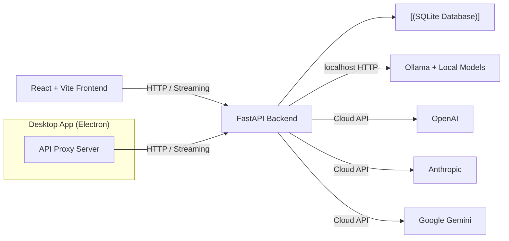

                                                                                                                            
 ```
 _____                   ____             _____       _____       _____                       _____          ____________   
|\    \              ____\_  \__     _____\    \_   /      |_    |\    \                    /      |_       /            \  
 \\    \            /     /     \   /     /|     | /         \    \\    \                  /         \     |\___/\  \\___/| 
  \\    \          /     /\      | /     / /____/||     /\    \    \\    \                |     /\    \     \|____\  \___|/ 
   \|    | ______ |     |  |     ||     | |____|/ |    |  |    \    \|    | ______        |    |  |    \          |  |      
    |    |/      \|     |  |     ||     |  _____  |     \/      \    |    |/      \       |     \/      \    __  /   / __   
    /            ||     | /     /||\     \|\    \ |\      /\     \   /            |       |\      /\     \  /  \/   /_/  |  
   /_____/\_____/||\     \_____/ || \_____\|    | | \_____\ \_____\ /_____/\_____/|       | \_____\ \_____\|____________/|  
  |      | |    ||| \_____\   | / | |     /____/| | |     | |     ||      | |    ||       | |     | |     ||           | /  
  |______|/|____|/ \ |    |___|/   \|_____|    ||  \|_____|\|_____||______|/|____|/        \|_____|\|_____||___________|/   
                    \|____|               |____|/                                                                            
 ```

# Local AI Control Center

> **A private, local-first AI workspace** — chat with Ollama and cloud models, compare responses, organize conversations, and analyze your usage — all running on your machine.

[](https://python.org)
[](https://fastapi.tiangolo.com)
[](https://reactjs.org)
[](https://typescriptlang.org)
[](LICENSE)

> Liever in het Nederlands? Lees de [Nederlandstalige README](README.nl.md).

---

## Table of Contents

- [What is this?](#what-is-this)
- [Features](#features)
  - [Chat](#chat)
  - [Organization](#organization)
  - [Productivity](#productivity)
  - [Tools](#tools)
  - [Interface](#interface)
  - [Desktop App](#desktop-app)
- [Keyboard Shortcuts](#keyboard-shortcuts)
- [Tech Stack and Architecture](#tech-stack-and-architecture)
- [Installation](#installation)
  - [Requirements](#requirements)
  - [1. Start Ollama and Install a Model](#1-start-ollama-and-install-a-model)
  - [2. Start the API](#2-start-the-api)
  - [3. Start the Frontend](#3-start-the-frontend)
- [Desktop App](#desktop-app-1)
  - [Electron App](#electron-app)
  - [PyInstaller Portable Build](#pyinstaller-portable-build)
- [Configuration](#configuration)
- [API Reference](#api-reference)
  - [Health](#health)
  - [Ollama Status](#ollama-status)
  - [Conversations](#conversations)
  - [Messages](#messages)
  - [Chat](#chat-1)
  - [Playground](#playground)
  - [Providers](#providers)
  - [Presets](#presets)
  - [Quick Prompts](#quick-prompts)
  - [Tags](#tags)
  - [Statistics](#statistics)
  - [Tools](#tools-1)
- [Database Schema](#database-schema)
- [Development and Testing](#development-and-testing)
- [Security and Local Use](#security-and-local-use)
- [Project Structure](#project-structure)
- [AI-Assisted Development](#ai-assisted-development)

---

## What is this?

Local AI Control Center is a locally running dashboard for AI models. Stream conversations, manage chat history, inspect generation statistics, and compare the same prompt across multiple installed models. The frontend and API run on localhost; conversations and messages are stored in a local SQLite database.

Supports **Ollama** for local models and **cloud providers** (OpenAI, Anthropic, Google Gemini) via configurable API keys — all from a single unified interface.

---

## Features

### Chat

- **Streaming chat** with real-time token-by-token responses persisted in SQLite
- **System prompts** per conversation for customized AI behavior
- **Message editing** — edit your sent messages inline and get a fresh response
- **Response regeneration** — re-generate the last AI response with one click
- **Message timestamps** — see when each message was created
- **Copy to clipboard** — one-click copy on every message with visual feedback
- **Delete individual messages** from conversations
- **Generation statistics** — time, prompt eval time, token count, and tokens/second
- **Markdown rendering** — responses formatted with lists, tables, code blocks, and more
- **Word and character count** — live count while typing your message

### Organization

- **Search conversations** — full-text search across titles AND message content
- **Pin conversations** — keep important chats at the top of the list
- **Conversation tags** — create, color, and assign tags to organize your chats
- **Rename conversations** — inline renaming with auto-title from first message
- **Export conversations** — download as Markdown or JSON for backup and sharing
- **Import conversations** — restore from previously exported JSON files
- **Delete conversations** — remove conversations and all associated messages

### Productivity

- **Model presets** — save and apply model configurations (model, system prompt, temperature, max tokens)
- **Quick Prompts** — save reusable prompt templates with categories and quick insertion
- **Conversation statistics** — view message counts, token usage, average speed, and more
- **Provider switching** — switch between Ollama and cloud providers per conversation

### Tools

- **Prompt Playground** — run one prompt across 2–4 models in parallel and compare results
- **Document Q&A** — upload `.txt` and `.md` files and ask questions about their content
- **Code explanation** — paste code and get a clear explanation of what it does

### Interface

- **Dark/light theme** — responsive interface that adapts to your system preference
- **Bilingual support** — English and Dutch interface, language preference saved locally
- **Loading, empty, and error states** — clear feedback for every interaction
- **Keyboard navigation** — full keyboard support for conversation list and controls
- **Icon buttons** — intuitive icons from Lucide React for all actions

### Desktop App

- **Electron app** — standalone desktop application with system tray support
- **Minimize to tray** — close window minimizes to system tray instead of quitting
- **PyInstaller portable build** — single `.exe` folder, no installation required
- **Auto-started backend** — the Python backend starts automatically with the desktop app

---

## Keyboard Shortcuts

| Shortcut | Action |
| --- | --- |
| `/` | Open the conversations menu and focus the search field |
| `⌘ K` / `Ctrl K` | Start a new conversation |
| `↑` / `↓` | Move the highlight through the conversation list |
| `Home` / `End` | Jump to the first / last conversation |
| `Enter` | Open the highlighted conversation |
| `Esc` | Close the conversations menu or model picker |

In the conversation list, the highlight also follows the mouse. Shortcut hints appear when you hover or focus a control.

---

## Tech Stack and Architecture

| Component | Technology |
| --- | --- |
| Frontend | React 18, TypeScript 5, Vite |
| API | Python 3.11+, FastAPI |
| Storage | SQLite with foreign key constraints |
| Local AI | Ollama HTTP API |
| Cloud AI | OpenAI, Anthropic, Google Gemini (via server-side API keys) |
| Python environment | uv (fast Python package installer) |
| Backend tests | pytest with mocked Ollama requests |
| Linting | Ruff for Python, Prettier for frontend |
| Desktop | Electron (cross-platform) and PyInstaller (Windows portable) |



---

## Installation

### Requirements

- **Python 3.11** or newer
- **[uv](https://docs.astral.sh/uv/)** — fast Python package installer
- **Node.js 20.19+** or **22.12+**
- **[Ollama](https://ollama.com/download)** installed locally (for local models)

### 1. Start Ollama and install a model

Ollama normally runs as a background service. If it is not already running, start it in a terminal:

```sh
ollama serve
```

In another terminal, install any model you want to use, for example:

```sh
ollama pull qwen2.5:7b
```

Model downloads are managed by Ollama. The dashboard does not pull or delete models.

### 2. Start the API

Run these commands from the repository root:

```sh
cd backend
uv sync
uv run python -m app
```

The API listens on `127.0.0.1:8000` by default. The SQLite database is created under `backend/data/` the first time the API starts.

### 3. Start the frontend

Open a second terminal from the repository root:

```sh
cd frontend
npm ci
npm run dev
```

Open the local URL printed by Vite (normally `http://127.0.0.1:5173`). The Vite development server proxies `/api` requests to the FastAPI server. If port 5173 is already in use, Vite may choose another port; use the URL printed in the terminal.

---

## Desktop App

### Electron App

Build and run the Electron desktop application:

```powershell
cd Desktop
npm ci
npm start
```

The Electron app automatically starts the Python backend and serves the frontend via a built-in proxy server. It includes system tray support — closing the window minimizes to the tray instead of quitting.

To build a distributable package:

```powershell
cd Desktop
npm run build
```

This creates NSIS installers and portable executables in `Desktop/release/`.

### PyInstaller Portable Build

Build a standalone Windows `.exe` using the included build script:

```powershell
.\build-desktop.ps1
```

This script:
1. Builds the React frontend production bundle
2. Installs Python desktop dependencies (`pywebview`, `pyinstaller`)
3. Packages everything into a portable folder using PyInstaller

The output is a self-contained folder in `dist-desktop/` — copy it anywhere and run the `.exe`. No installation, no PowerShell, no browser tabs needed.

---

## Configuration

Defaults target Ollama at `http://127.0.0.1:11434`, store SQLite data at `backend/data/local-ai-control-center.db`, and bind the API to localhost. Optional API settings use the `LACC_` prefix:

| Variable | Default | Purpose |
| --- | --- | --- |
| `LACC_OLLAMA_BASE_URL` | `http://127.0.0.1:11434` | Ollama HTTP API address |
| `LACC_DATABASE_URL` | `sqlite:///./data/local-ai-control-center.db` | SQLite database path (relative to `backend/`) |
| `LACC_HOST` | `127.0.0.1` | API bind address |
| `LACC_PORT` | `8000` | API port |
| `LACC_REQUEST_TIMEOUT_SECONDS` | `10` | Ollama connection and request timeout; response reads allow up to 5 minutes |
| `LACC_OPENAI_API_KEY` | — | Enables OpenAI cloud models |
| `LACC_ANTHROPIC_API_KEY` | — | Enables Anthropic cloud models |
| `LACC_GEMINI_API_KEY` | — | Enables Google Gemini cloud models |
| `LACC_DEFAULT_PROVIDER` | `ollama` | Default provider (`ollama`, `openai`, `anthropic`, or `google`) |

Copy `.env.example` to `.env` in the repository root to customize settings. Start the API from `backend/` so the relative SQLite path resolves to `backend/data/`. The API’s CORS allowlist is restricted to local Vite development origins.

The Vite `/api` proxy targets `http://127.0.0.1:8000` by default. If you run the API on another port, set `VITE_API_TARGET` before starting Vite. For example, in PowerShell:

```powershell
$env:VITE_API_TARGET = 'http://127.0.0.1:18080'
```

---

## API Reference

All endpoints are prefixed with `/api`. The API returns JSON responses unless noted otherwise.

### Health

| Method | Endpoint | Description |
| --- | --- | --- |
| `GET` | `/api/health` | Health check — returns `{"status": "ok"}` |

### Ollama Status

| Method | Endpoint | Description |
| --- | --- | --- |
| `GET` | `/api/ollama/status` | Check Ollama connection status |
| `GET` | `/api/ollama/models` | List installed Ollama models |

### Conversations

| Method | Endpoint | Description |
| --- | --- | --- |
| `GET` | `/api/conversations` | List all conversations (optional `?search=` query) |
| `POST` | `/api/conversations` | Create a new conversation |
| `POST` | `/api/conversations/import` | Import a conversation from JSON |
| `GET` | `/api/conversations/{id}` | Get conversation with all messages |
| `PATCH` | `/api/conversations/{id}` | Rename conversation (optionally update system prompt) |
| `DELETE` | `/api/conversations/{id}` | Delete conversation and all messages |
| `POST` | `/api/conversations/{id}/pin` | Pin conversation to top of list |
| `POST` | `/api/conversations/{id}/unpin` | Unpin conversation |
| `GET` | `/api/conversations/{id}/export` | Export as Markdown (`?format=markdown`) or JSON (`?format=json`) |

### Messages

| Method | Endpoint | Description |
| --- | --- | --- |
| `POST` | `/api/conversations/{id}/messages` | Add a message to a conversation |
| `PUT` | `/api/conversations/{id}/messages/{msg_id}` | Update a message's content |
| `DELETE` | `/api/conversations/{id}/messages/{msg_id}` | Delete a message |

### Chat

| Method | Endpoint | Description |
| --- | --- | --- |
| `POST` | `/api/chat/stream` | Stream a chat response (SSE) |
| `POST` | `/api/chat/regenerate` | Regenerate the last assistant response (SSE) |

**Chat request body:**
```json
{
  "conversation_id": "uuid",
  "model": "qwen2.5:7b",
  "message": "Your message",
  "system_prompt": "Optional system prompt",
  "edit_message_id": "uuid or null",
  "regenerate": false
}
```

**Streaming response format (Server-Sent Events):**
```
data: {"type": "token", "content": "Hello"}

data: {"type": "done", "total_duration": 1234567890, "eval_count": 150, "eval_duration": 987654321}
```

### Playground

| Method | Endpoint | Description |
| --- | --- | --- |
| `POST` | `/api/playground/compare` | Run a prompt across 2–4 models in parallel |

**Request body:**
```json
{
  "prompt": "Explain quantum computing",
  "models": ["llama3.1:8b", "qwen2.5:7b"]
}
```

### Providers

| Method | Endpoint | Description |
| --- | --- | --- |
| `GET` | `/api/providers` | List available AI providers |
| `GET` | `/api/providers/{id}/models` | List models for a specific provider |
| `POST` | `/api/providers/chat/stream` | Stream chat via any provider (SSE) |

### Presets

| Method | Endpoint | Description |
| --- | --- | --- |
| `GET` | `/api/presets` | List all saved model presets |
| `POST` | `/api/presets` | Create a new preset |
| `GET` | `/api/presets/{id}` | Get a preset by ID |
| `PUT` | `/api/presets/{id}` | Update a preset |
| `DELETE` | `/api/presets/{id}` | Delete a preset |

**Preset body:**
```json
{
  "name": "Creative Writer",
  "model": "qwen2.5:7b",
  "system_prompt": "You are a creative writer.",
  "temperature": 0.9,
  "max_tokens": 4096
}
```

### Quick Prompts

| Method | Endpoint | Description |
| --- | --- | --- |
| `GET` | `/api/prompts` | List all quick prompts (optional `?category=` filter) |
| `GET` | `/api/prompts/categories` | List all prompt categories |
| `POST` | `/api/prompts` | Create a new quick prompt |
| `GET` | `/api/prompts/{id}` | Get a prompt by ID |
| `PUT` | `/api/prompts/{id}` | Update a prompt |
| `DELETE` | `/api/prompts/{id}` | Delete a prompt |

### Tags

| Method | Endpoint | Description |
| --- | --- | --- |
| `GET` | `/api/tags` | List all tags with conversation counts |
| `POST` | `/api/tags` | Create a new tag |
| `PUT` | `/api/tags/{id}` | Update a tag (name or color) |
| `DELETE` | `/api/tags/{id}` | Delete a tag |
| `POST` | `/api/tags/{conv_id}/tags` | Set tags for a conversation |
| `GET` | `/api/tags/{conv_id}/tags` | Get tags for a conversation |
| `GET` | `/api/tags/conversations/{name}` | List conversations with a specific tag |

### Statistics

| Method | Endpoint | Description |
| --- | --- | --- |
| `GET` | `/api/stats/conversations/{id}` | Get detailed stats for a conversation |
| `GET` | `/api/stats/overview` | Get overview stats for all conversations |

**Conversation stats response:**
```json
{
  "conversation_id": "uuid",
  "user_messages": 5,
  "assistant_messages": 5,
  "total_messages": 10,
  "total_tokens": 1500,
  "average_tokens_per_response": 150,
  "average_speed_tokens_per_second": 45.2,
  "total_characters": 8500
}
```

### Tools

| Method | Endpoint | Description |
| --- | --- | --- |
| `GET` | `/api/tools/documents` | List uploaded documents |
| `POST` | `/api/tools/documents` | Upload a `.txt` or `.md` document |
| `DELETE` | `/api/tools/documents/{id}` | Delete a document |
| `POST` | `/api/tools/documents/ask` | Ask a question about uploaded documents |
| `POST` | `/api/tools/explain-code` | Get an explanation of code |

---

## Database Schema

The application uses SQLite with the following tables:

| Table | Description |
| --- | --- |
| `conversations` | Chat sessions with title, model, system prompt, pinned status |
| `messages` | Individual messages with role, content, and generation stats |
| `documents` | Uploaded text/markdown files for Q&A |
| `presets` | Saved model configurations |
| `tags` | Named, colored tags for organization |
| `conversation_tags` | Many-to-many mapping between conversations and tags |
| `quick_prompts` | Reusable prompt templates with categories |

All tables use UUIDs as primary keys. Foreign keys are enforced with cascading deletes. The database auto-creates on first run with backward-compatible migrations for new columns.

---

## Development and Testing

Backend tests use mocked Ollama responses; no Ollama instance needs to be running:

```sh
cd backend
uv run python -m pytest
uv run python -m ruff check app tests
```

Check formatting and build the frontend:

```sh
cd frontend
npm ci
npm run format:check
npm run build
```

---

## Security and Local Use

- **Local-only binding** — Keep the API and frontend bound to `127.0.0.1` for local use. Do not expose them to a network without adding authentication and reviewing CORS and access controls.
- **Trusted Ollama endpoint** — The Ollama base URL is configurable for local setups; set it only to an endpoint you trust.
- **No authentication** — The API does not provide authentication because it is intended to run locally. Anyone who can access the bound local service can use it.
- **Local data storage** — Prompts, messages, conversation titles, and added document contents are stored in the local SQLite database. The database is excluded from version control.
- **API key security** — Cloud API keys live only in the server's private environment (`.env`, kept out of source control, `chmod 600`). The browser never receives them.
- **Cloud provider terms** — When using cloud providers, prompts and conversation content are sent to the provider's API. Review provider terms and charges.
- **Cloud usage charges** — Cloud model usage may incur charges from the provider and is subject to the provider's terms.
- **Playground safety** — Prompt Playground only accepts models reported as installed by the configured Ollama service. It does not download or delete models.
- **Document tool limits** — The document tool stores text in SQLite and selects relevant passages with keyword matching; it is not a semantic search engine. Only `.txt` and `.md` files up to 200 KB are accepted.

---

## Project Structure

```text
Local-AI/
├── backend/                    # FastAPI API server
│   ├── app/
│   │   ├── api/                # API route modules
│   │   │   ├── chat.py         # Streaming chat and regeneration
│   │   │   ├── conversations.py # Conversation CRUD, pin, import, export
│   │   │   ├── messages.py     # Message CRUD
│   │   │   ├── playground.py   # Multi-model comparison
│   │   │   ├── presets.py      # Model preset management
│   │   │   ├── prompts.py      # Quick prompt templates
│   │   │   ├── providers.py    # Cloud provider chat
│   │   │   ├── stats.py        # Conversation and overview statistics
│   │   │   ├── tags.py         # Tag management and associations
│   │   │   └── tools.py        # Document Q&A and code explanation
│   │   ├── core/               # Core configuration and providers
│   │   │   ├── config.py       # Pydantic settings with env vars
│   │   │   └── providers.py    # Provider registry and abstraction
│   │   ├── db/                 # Database schema and migrations
│   │   │   └── database.py     # SQLite init, connect, migrations
│   │   ├── ollama/             # Ollama HTTP client
│   │   │   └── client.py       # Async streaming client
│   │   └── main.py             # FastAPI app entry point
│   ├── data/                   # SQLite database (git-ignored)
│   ├── tests/                  # Pytest test suite
│   │   └── test_api.py         # 77+ tests for all API endpoints
│   ├── pyproject.toml          # Python dependencies
│   └── uv.lock                 # Locked dependency versions
├── frontend/                   # React + Vite application
│   ├── src/
│   │   ├── App.tsx             # Main chat interface
│   │   ├── Playground.tsx      # Multi-model comparison
│   │   ├── Tools.tsx           # Document Q&A and code explanation
│   │   ├── api/client.ts       # API client with all endpoints
│   │   ├── i18n.ts             # English and Dutch translations
│   │   ├── style.css           # All styles and themes
│   │   └── main.tsx            # Entry point
│   ├── package.json            # Frontend dependencies
│   └── vite.config.ts          # Vite configuration with API proxy
├── Desktop/                    # Electron desktop application
│   ├── electron/
│   │   ├── main.js             # Electron main process
│   │   └── preload.js          # Preload script for IPC
│   └── package.json            # Electron dependencies and build config
├── build-desktop.ps1           # PyInstaller portable build script
├── desktop_app.py              # PyInstaller entry point
├── README.md                   # This file
└── README.nl.md                # Dutch translation
```

---

## AI-Assisted Development

This project was developed with extensive use of **ChatGPT and OpenAI Codex** as AI development tools.

I used ChatGPT to help define the project scope, architecture, features, technical decisions, and development approach. **OpenAI Codex was then used as the coding agent to implement and iterate on the application.**

I was responsible for:

- defining the requirements and desired functionality
- making architectural and technical decisions
- directing the implementation through iterative prompts
- testing the application and integrations
- reviewing and correcting the generated implementation
- debugging issues during development
- setting up the Git/GitHub workflow and project documentation
