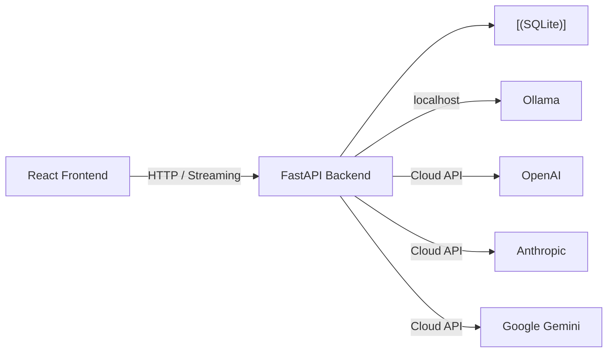

# Neo: Your Private AI Workspace

> Chat with AI models locally and in the cloud, all from one private dashboard running on your machine.

[](https://python.org)
[](https://fastapi.tiangolo.com)
[](https://reactjs.org)
[](https://typescriptlang.org)
[](LICENSE)

---

## ✨ What can you do with Neo?

Neo is your personal AI chat workspace. Think of it as a private, self-hosted alternative to chat apps – your conversations never leave your computer unless you choose cloud models.

**Chat** with any AI model – local (Ollama) or cloud (OpenAI, Anthropic, Gemini) – with streaming responses, message editing, bookmarks, and conversation summaries.

**Organize** your chats with search, tags, pins, and export to Markdown or JSON.

**Compare** models side-by-side in the Playground to see which one gives the best answer.

**Boost productivity** with saved model presets, quick prompt templates, and built-in tools like Document Q&A and code explanation.

**Go offline** – with Ollama, everything runs locally with zero internet connection needed.

---

## 🚀 Get started in 3 minutes

### Prerequisites

- **Python 3.11+** and **[uv](https://docs.astral.sh/uv/)** (fast Python package manager)
- **Node.js 20.19+** or **22.12+**
- **[Ollama](https://ollama.com/download)** (for local AI models)

### Step 1: Install an AI model

```sh
ollama pull qwen2.5:7b
```

Any Ollama model works. The dashboard doesn't pull or delete models – Ollama manages them.

### Step 2: Start the backend

```sh
cd backend
uv sync
uv run python -m app
```

The API starts on `http://127.0.0.1:8000`.

### Step 3: Start the frontend

```sh
cd frontend
npm ci
npm run dev
```

Open the URL Vite prints (usually `http://127.0.0.1:5173`). You're ready to chat!

---

## 🖥️ Desktop App

Prefer a standalone app over browser tabs? Neo has two options:

| Option | Description |
|---|---|
| **Electron App** | Cross-platform desktop app with system tray support |
| **Portable Build** | Single `.exe` folder for Windows, no installation needed |

### Electron App

```powershell
cd Desktop
npm ci
npm start
```

To build a distributable package: `npm run build` → output in `Desktop/release/`.

### Portable Build (Windows)

```powershell
.\build-desktop.ps1
```

Creates a self-contained folder in `dist-desktop/` – copy it anywhere and run.

---

## 🎯 Key Features

### 💬 Chat

- **Streaming responses**: see tokens appear in real-time
- **Message editing**: change your message and get a fresh response
- **Response regeneration**: re-roll the last AI answer with one click
- **Bookmarks**: save important messages for quick reference
- **Conversation summaries**: AI-generated recap of long chats
- **Markdown rendering**: formatted responses with code blocks, tables, and lists
- **Generation stats**: token count, speed, and timing for every response
- **File uploads**: attach text files, code, and images directly in chat
- **Voice input**: speak your messages using speech-to-text
- **Plugin tools**: AI can use web search, calculator, and file reading tools

### 📂 Organization

- **Full-text search**: find conversations by title or message content
- **Pin conversations**: keep important chats at the top
- **Tags**: color-coded labels to categorize your chats
- **Export/Import**: download as Markdown or JSON, restore later
- **Rename**: inline renaming with auto-generated titles

### ⚡ Productivity

- **Model presets**: save your favorite model configurations
- **Quick Prompts**: reusable prompt templates with categories
- **Statistics**: track token usage, message counts, and average speed
- **Provider switching**: switch between Ollama and cloud models per conversation

### 🛠️ Tools

- **Prompt Playground**: run one prompt across 2–4 models and compare
- **Document Q&A**: upload files and ask questions about their content
- **Code explanation**: paste code and get a clear breakdown

### 🎨 Interface

- **Dark/light theme**: follows your system preference
- **Bilingual**: English and Dutch interface
- **Keyboard shortcuts**: fast navigation without the mouse
- **Desktop app**: standalone window with system tray support

---

## ⌨️ Keyboard Shortcuts

| Shortcut | Action |
|---|---|
| `/` | Open conversations menu and focus search |
| `Ctrl N` | New conversation |
| `Ctrl K` | Focus search |
| `Ctrl Enter` | Send message |
| `↑` / `↓` | Navigate conversation list |
| `Enter` | Open highlighted conversation |
| `Esc` | Close menus and modals |

---

## ⚙️ Configuration

Neo works out of the box with Ollama. For cloud models or custom settings, copy `.env.example` to `.env`:

| Variable | Default | Purpose |
|---|---|---|
| `LACC_OLLAMA_BASE_URL` | `http://127.0.0.1:11434` | Ollama API address |
| `LACC_DATABASE_URL` | `sqlite:///./data/neo.db` | Database path |
| `LACC_HOST` | `127.0.0.1` | API bind address |
| `LACC_PORT` | `8000` | API port |
| `LACC_OPENAI_API_KEY` | *None* | Enable OpenAI models |
| `LACC_ANTHROPIC_API_KEY` | *None* | Enable Anthropic models |
| `LACC_GEMINI_API_KEY` | *None* | Enable Google Gemini models |
| `LACC_DEFAULT_PROVIDER` | `ollama` | Default provider |

---

## 🏗️ Tech Stack

| Component | Technology |
|---|---|
| Frontend | React 18, TypeScript 5, Vite |
| API | Python 3.11+, FastAPI |
| Storage | SQLite |
| Local AI | Ollama HTTP API |
| Cloud AI | OpenAI, Anthropic, Google Gemini |
| Desktop | Electron + PyInstaller |



---

## 📖 API Reference

All endpoints are prefixed with `/api`. See the [full API docs](#) for details.

### Core Endpoints

| Method | Endpoint | Description |
|---|---|---|
| `GET` | `/api/health` | Health check |
| `GET` | `/api/ollama/status` | Check Ollama connection |
| `GET` | `/api/ollama/models` | List installed models |
| `POST` | `/api/chat/stream` | Stream a chat response (SSE) |
| `POST` | `/api/chat/upload` | Upload a file for context |

### Conversations

| Method | Endpoint | Description |
|---|---|---|
| `GET` | `/api/conversations` | List all conversations |
| `POST` | `/api/conversations` | Create new conversation |
| `GET` | `/api/conversations/{id}` | Get conversation with messages |
| `PATCH` | `/api/conversations/{id}` | Rename conversation |
| `DELETE` | `/api/conversations/{id}` | Delete conversation |
| `GET` | `/api/conversations/{id}/export` | Export as Markdown or JSON |

### Tools

| Method | Endpoint | Description |
|---|---|---|
| `GET` | `/api/tools/documents` | List uploaded documents |
| `POST` | `/api/tools/documents` | Upload a document |
| `POST` | `/api/tools/documents/ask` | Ask about documents |

> **Full API reference:** For the complete list of all endpoints (presets, tags, bookmarks, statistics, providers, etc.), see the [API Reference Appendix](#api-reference-appendix) at the bottom of this file.

---

## 🔒 Security & Privacy

- **Local-only by default**: API binds to `127.0.0.1`, not accessible from outside your machine
- **No authentication**: designed for local single-user use; don't expose to a network without adding auth
- **Your data stays local**: conversations stored in SQLite on your machine
- **API keys are server-side**: cloud API keys never reach the browser
- **Cloud provider terms**: when using cloud models, content is sent to the provider's API

---

## 🧪 Development & Testing

```sh
# Backend tests (no Ollama needed)
cd backend
uv run python -m pytest

# Frontend build
cd frontend
npm run build
```

---

## 📁 Project Structure

```
Neo/
├── backend/           # FastAPI API server
│   ├── app/
│   │   ├── api/       # API routes (chat, conversations, messages, etc.)
│   │   ├── core/      # Config and provider registry
│   │   ├── db/        # Database schema and migrations
│   │   ├── ollama/    # Ollama HTTP client
│   │   ├── tools/     # Plugin tools (calculator, file read, web search)
│   │   └── main.py    # FastAPI entry point
│   └── data/          # SQLite database (git-ignored)
├── frontend/          # React + Vite application
│   └── src/
│       ├── components/ # UI components (Sidebar, ChatView, etc.)
│       ├── App.tsx     # Main chat interface
│       └── ...
├── Desktop/           # Electron desktop application
└── build-desktop.ps1  # PyInstaller portable build script
```

---

## 🤝 Contributing

Contributions are welcome! Please feel free to submit a Pull Request.

---

## 📜 License

MIT License – see [LICENSE](LICENSE) for details.

---

## 🤖 AI-Assisted Development

This project was developed with extensive use of AI development tools (ChatGPT, OpenAI Codex). The human developer defined requirements, made architectural decisions, directed implementation, tested, reviewed, and debugged the application.

---

## API Reference Appendix

<details>
<summary><strong>Click to expand full API reference</strong></summary>

### Health

| Method | Endpoint | Description |
|---|---|---|
| `GET` | `/api/health` | Health check, returns `{"status": "ok"}` |

### Ollama Status

| Method | Endpoint | Description |
|---|---|---|
| `GET` | `/api/ollama/status` | Check Ollama connection status |
| `GET` | `/api/ollama/models` | List installed Ollama models |

### Conversations

| Method | Endpoint | Description |
|---|---|---|
| `GET` | `/api/conversations` | List all conversations (optional `?search=` query) |
| `POST` | `/api/conversations` | Create a new conversation |
| `POST` | `/api/conversations/import` | Import a conversation from JSON |
| `GET` | `/api/conversations/{id}` | Get conversation with all messages |
| `PATCH` | `/api/conversations/{id}` | Rename conversation |
| `DELETE` | `/api/conversations/{id}` | Delete conversation and all messages |
| `POST` | `/api/conversations/{id}/pin` | Pin conversation to top |
| `POST` | `/api/conversations/{id}/unpin` | Unpin conversation |
| `GET` | `/api/conversations/{id}/export` | Export as Markdown or JSON |

### Messages

| Method | Endpoint | Description |
|---|---|---|
| `POST` | `/api/conversations/{id}/messages` | Add a message |
| `PUT` | `/api/conversations/{id}/messages/{msg_id}` | Update a message |
| `DELETE` | `/api/conversations/{id}/messages/{msg_id}` | Delete a message |

### Chat

| Method | Endpoint | Description |
|---|---|---|
| `POST` | `/api/chat/stream` | Stream a chat response (SSE) |
| `POST` | `/api/chat/regenerate` | Regenerate last response (SSE) |
| `POST` | `/api/chat/upload` | Upload a file for context |

**Chat request body:**
```json
{
  "conversation_id": "uuid",
  "model": "qwen2.5:7b",
  "message": "Your message",
  "system_prompt": "Optional system prompt",
  "edit_message_id": "uuid or null",
  "regenerate": false
}
```

### Playground

| Method | Endpoint | Description |
|---|---|---|
| `POST` | `/api/playground/compare` | Run a prompt across 2–4 models |

### Providers

| Method | Endpoint | Description |
|---|---|---|
| `GET` | `/api/providers` | List available AI providers |
| `GET` | `/api/providers/{id}/models` | List models for a provider |
| `POST` | `/api/providers/chat/stream` | Stream chat via any provider |

### Presets

| Method | Endpoint | Description |
|---|---|---|
| `GET` | `/api/presets` | List all saved presets |
| `POST` | `/api/presets` | Create a new preset |
| `GET` | `/api/presets/{id}` | Get a preset |
| `PUT` | `/api/presets/{id}` | Update a preset |
| `DELETE` | `/api/presets/{id}` | Delete a preset |

### Quick Prompts

| Method | Endpoint | Description |
|---|---|---|
| `GET` | `/api/prompts` | List all quick prompts |
| `GET` | `/api/prompts/categories` | List prompt categories |
| `POST` | `/api/prompts` | Create a new prompt |
| `PUT` | `/api/prompts/{id}` | Update a prompt |
| `DELETE` | `/api/prompts/{id}` | Delete a prompt |

### Tags

| Method | Endpoint | Description |
|---|---|---|
| `GET` | `/api/tags` | List all tags |
| `POST` | `/api/tags` | Create a new tag |
| `PUT` | `/api/tags/{id}` | Update a tag |
| `DELETE` | `/api/tags/{id}` | Delete a tag |
| `POST` | `/api/tags/{conv_id}/tags` | Set tags for a conversation |

### Statistics

| Method | Endpoint | Description |
|---|---|---|
| `GET` | `/api/stats/conversations/{id}` | Stats for a conversation |
| `GET` | `/api/stats/overview` | Overview stats |

### Bookmarks

| Method | Endpoint | Description |
|---|---|---|
| `GET` | `/api/bookmarks/conversations/{id}` | List bookmarked messages |
| `POST` | `/api/bookmarks/conversations/{id}/messages/{mid}` | Bookmark a message |
| `DELETE` | `/api/bookmarks/conversations/{id}/messages/{mid}` | Remove a bookmark |

### Summary

| Method | Endpoint | Description |
|---|---|---|
| `POST` | `/api/summary/stream` | Stream a conversation summary |

### Tools

| Method | Endpoint | Description |
|---|---|---|
| `GET` | `/api/tools/documents` | List uploaded documents |
| `POST` | `/api/tools/documents` | Upload a document |
| `DELETE` | `/api/tools/documents/{id}` | Delete a document |
| `POST` | `/api/tools/documents/ask` | Ask about documents |
| `POST` | `/api/tools/explain-code` | Explain code |

</details>

---

## Database Schema Appendix

<details>
<summary><strong>Click to expand database schema</strong></summary>

| Table | Description |
|---|---|
| `conversations` | Chat sessions with title, model, system prompt, pinned status |
| `messages` | Individual messages with role, content, and generation stats |
| `documents` | Uploaded text/markdown files for Q&A |
| `presets` | Saved model configurations |
| `tags` | Named, colored tags for organization |
| `conversation_tags` | Many-to-many mapping between conversations and tags |
| `quick_prompts` | Reusable prompt templates with categories |
| `bookmarks` | Bookmarked messages for quick reference |

All tables use UUIDs as primary keys. Foreign keys are enforced with cascading deletes. The database auto-creates on first run with backward-compatible migrations.

</details>
