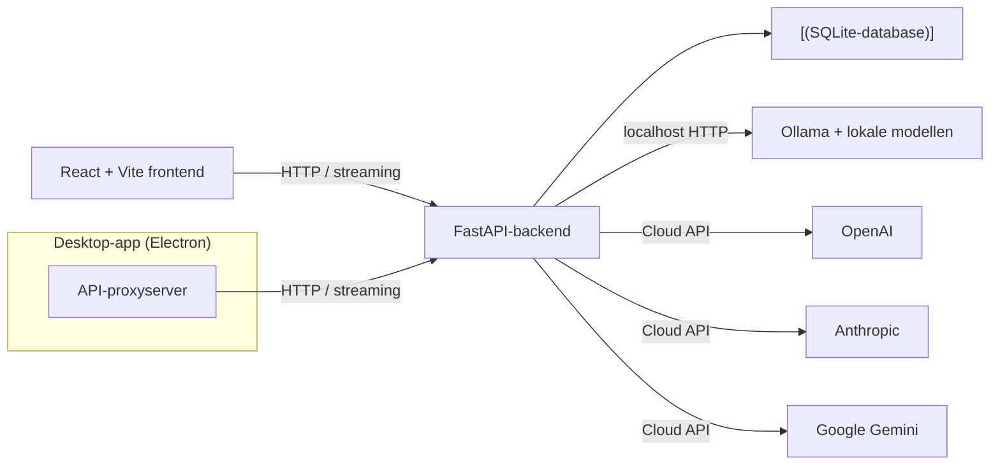

                                                                                    
```
       ____     ___________      ______  ______    ____________             _____   
   ____\_  \__  \          \     \     \|\     \  /            \       _____\    \  
  /     /     \  \    /\    \     |     |\|     ||\___/\  \\___/|     /    / \    | 
 /     /\      |  |   \_\    |    |     |/____ /  \|____\  \___|/    |    |  /___/| 
|     |  |     |  |      ___/     |     |\     \        |  |      ____\    \ |   || 
|     |  |     |  |      \  ____  |     | |     |  __  /   / __  /    /\    \|___|/ 
|     | /     /| /     /\ \/    \ |     | |     | /  \/   /_/  ||    |/ \    \      
|\     \_____/ |/_____/ |\______|/_____/|/_____/||____________/||\____\ /____/|     
| \_____\   | / |     | | |     ||    |||     | ||           | /| |   ||    | |     
 \ |    |___|/  |_____|/ \|_____||____|/|_____|/ |___________|/  \|___||____|/      
  \|____|                                                                            
```

# Orbis

> **Een privé, lokale AI-werkruimte**: chat met Ollama- en cloudmodellen, vergelijk antwoorden, organiseer gesprekken en analyseer je gebruik, alles draaiend op je eigen computer.

[](https://python.org)
[](https://fastapi.tiangolo.com)
[](https://reactjs.org)
[](https://typescriptlang.org)
[](LICENSE)

> Wil je de Engelse hoofdversie lezen? Bekijk de [English README](README.md).

---

## Inhoudsopgave

- [Wat is dit?](#wat-is-dit)
- [Functies](#functies)
  - [Chat](#chat)
  - [Organisatie](#organisatie)
  - [Productiviteit](#productiviteit)
  - [Tools](#tools)
  - [Interface](#interface)
  - [Desktop-app](#desktop-app)
- [Sneltoetsen](#sneltoetsen)
- [Techniek en architectuur](#techniek-en-architectuur)
- [Installatie](#installatie)
  - [Benodigdheden](#benodigdheden)
  - [1. Start Ollama en installeer een model](#1-start-ollama-en-installeer-een-model)
  - [2. Start de API](#2-start-de-api)
  - [3. Start de frontend](#3-start-de-frontend)
- [Desktop-app](#desktop-app-1)
  - [Electron-app](#electron-app)
  - [PyInstaller Portable Build](#pyinstaller-portable-build)
- [Configuratie](#configuratie)
- [API-referentie](#api-referentie)
  - [Gezondheid](#gezondheid)
  - [Ollama-status](#ollama-status)
  - [Gesprekken](#gesprekken)
  - [Berichten](#berichten)
  - [Chat](#chat-1)
  - [Speeltuin](#speeltuin)
  - [Providers](#providers)
  - [Voorinstellingen](#voorinstellingen)
  - [Snelle Prompts](#snelle-prompts)
  - [Labels](#labels)
  - [Statistieken](#statistieken)
  - [Tools](#tools-1)
- [Database-schema](#database-schema)
- [Ontwikkelen en testen](#ontwikkelen-en-testen)
- [Beveiliging en lokaal gebruik](#beveiliging-en-lokaal-gebruik)
- [Projectstructuur](#projectstructuur)
- [AI-ondersteunde ontwikkeling](#ai-ondersteunde-ontwikkeling)

---

## Wat is dit?

Orbis is een lokaal draaiend dashboard voor AI-modellen. Je kunt gesprekken streamen, eerdere gesprekken beheren, generatiestatistieken bekijken en dezelfde prompt met meerdere geïnstalleerde modellen vergelijken. De frontend en API draaien op localhost; gesprekken en berichten worden opgeslagen in een lokale SQLite-database.

Ondersteunt **Ollama** voor lokale modellen en **cloudproviders** (OpenAI, Anthropic, Google Gemini) via configureerbare API-sleutels, alles vanuit één uniforme interface.

---

## Functies

### Chat

- **Chatten met streaming**: real-time token-voor-token-antwoorden opgeslagen in SQLite
- **Systeemprompts** per gesprek voor aangepast AI-gedrag
- **Berichtbewerking**: bewerk je verzonden berichten inline en ontvang een nieuw antwoord
- **Antwoordregeneratie**: genereer het laatste AI-antwoord opnieuw met één klik
- **Berichttijdstempels**: zie wanneer elk bericht is aangemaakt
- **Kopiëren naar klembord**: één-klik-kopiëren op elk bericht met visuele feedback
- **Berichtmarkeringen**: markeer belangrijke berichten voor snelle referentie
- **Gesprekssamenvatting**: AI-gestuurde samenvatting van lange gesprekken
- **Individuele berichten verwijderen** uit gesprekken
- **Generatiestatistieken**: tijd, prompt-evaluatietijd, tokenaantal en tokens/seconde
- **Markdown-weergave**: antwoorden opgemaakt met lijsten, tabellen, codeblokken en meer
- **Woord- en tekentelling**: live telling tijdens het typen van je bericht

### Organisatie

- **Gesprekken zoeken**: volledige tekstzoekfunctie door titels EN berichtinhoud
- **Gesprekken vastmaken**: houd belangrijke chats bovenaan de lijst
- **Gesprekstags**: maak, kleur en wijs tags toe om je chats te organiseren
- **Gesprekken hernoemen**: inline hernoemen met automatische titel uit eerste bericht
- **Gesprekken exporteren**: download als Markdown of JSON voor back-up en delen
- **Gesprekken importeren**: herstel uit eerder geëxporteerde JSON-bestanden
- **Gesprekken verwijderen**: verwijder gesprekken en alle bijbehorende berichten

### Productiviteit

- **Modelvoorinstellingen**: sla en pas modelconfiguraties toe (model, systeemprompt, temperatuur, max tokens)
- **Snelle Prompts**: sla herbruikbare promptsjablonen op met categorieën en snel invoegen
- **Gespreksstatistieken**: bekijk berichtaantallen, tokengebruik, gemiddelde snelheid en meer
- **Providerwisseling**: wissel tussen Ollama en cloudproviders per gesprek

### Tools

- **Prompt-speeltuin**: voer één prompt parallel uit met 2–4 modellen en vergelijk resultaten
- **Document Q&A**: upload `.txt`- en `.md`-bestanden en stel vragen over de inhoud
- **Code-uitleg**: plak code en ontvang een duidelijke uitleg van wat het doet

### Interface

- **Donker/licht thema**: responsieve interface die zich aanpast aan je systeemvoorkeur
- **Tweetaalige ondersteuning**: Engelse en Nederlandse interface, taalvoorkeur lokaal opgeslagen
- **Laad-, lege- en foutstatussen**: duidelijke feedback voor elke interactie
- **Toetsenbordnavigatie**: volledige toetsenbordondersteuning voor gesprekkenlijst en besturingselementen
- **Pictogramknoppen**: intuïtieve pictogrammen van Lucide React voor alle acties

### Desktop-app

- **Electron-app**: standalone desktopapplicatie met systeemvakondersteuning
- **Minimaliseren naar systeemvak**: venster sluiten minimaliseert naar systeemvak in plaats van afsluiten
- **PyInstaller portable build**: enkele `.exe`-map, geen installatie vereist
- **Automatisch gestarte backend**: de Python-backend start automatisch met de desktop-app

---

## Sneltoetsen

| Sneltoets | Actie |
| --- | --- |
| `/` | Open het gesprekkenmenu en focus het zoekveld |
| `⌘ K` / `Ctrl K` | Nieuw gesprek starten |
| `↑` / `↓` | Verplaats de markering door de gesprekkenlijst |
| `Home` / `End` | Naar het eerste / laatste gesprek springen |
| `Enter` | Het gemarkeerde gesprek openen |
| `Esc` | Het gesprekkenmenu of modelkiezer sluiten |

In de gesprekkenlijst volgt de markering ook de muis. Sneltoets-hints verschijnen wanneer je over een element gaat of het focus geeft.

---

## Techniek en architectuur

| Onderdeel | Technologie |
| --- | --- |
| Frontend | React 18, TypeScript 5, Vite |
| API | Python 3.11+, FastAPI |
| Opslag | SQLite met foreign key-constraints |
| Lokale AI | Ollama HTTP API |
| Cloud AI | OpenAI, Anthropic, Google Gemini (via server-side API-sleutels) |
| Python-omgeving | uv (snelle Python-pakketteninstallatie) |
| Backendtests | pytest met nagebootste Ollama-verzoeken |
| Linting | Ruff voor Python, Prettier voor frontend |
| Desktop | Electron (cross-platform) en PyInstaller (Windows portable) |



---

## Installatie

### Benodigdheden

- **Python 3.11** of nieuwer
- **[uv](https://docs.astral.sh/uv/)**: snelle Python-pakketteninstallatie
- **Node.js 20.19+** of **22.12+**
- **[Ollama](https://ollama.com/download)** lokaal geïnstalleerd (voor lokale modellen)

### 1. Start Ollama en installeer een model

Ollama draait meestal als achtergrondservice. Start het zo nodig in een terminal:

```sh
ollama serve
```

Installeer in een andere terminal een model, bijvoorbeeld:

```sh
ollama pull qwen2.5:7b
```

Ollama beheert modeldownloads. Het dashboard downloadt of verwijdert geen modellen.

### 2. Start de API

Voer dit uit vanuit de hoofdmap van de repository:

```sh
cd backend
uv sync
uv run python -m app
```

De API luistert standaard op `127.0.0.1:8000`. De SQLite-database wordt bij de eerste start aangemaakt in `backend/data/`.

### 3. Start de frontend

Open een tweede terminal in de hoofdmap:

```sh
cd frontend
npm ci
npm run dev
```

Open de lokale URL die Vite toont, meestal `http://127.0.0.1:5173`. De Vite-ontwikkelserver stuurt `/api`-verzoeken door naar de FastAPI-server. Als poort 5173 bezet is, kiest Vite mogelijk automatisch een andere poort; gebruik dan de URL uit de terminal.

---

## Desktop-app

### Electron-app

Bouw en start de Electron-desktopapplicatie:

```powershell
cd Desktop
npm ci
npm start
```

De Electron-app start automatisch de Python-backend en serveert de frontend via een ingebouwde proxyserver. Het bevat systeemvakondersteuning: het sluiten van het venster minimaliseert naar het systeemvak in plaats van afsluiten.

Voor het bouwen van een distribueerbaar pakket:

```powershell
cd Desktop
npm run build
```

Dit maakt NSIS-installatieprogramma's en portable uitvoerbare bestanden aan in `Desktop/release/`.

### PyInstaller Portable Build

Bouw een standalone Windows `.exe` met het meegeleverde buildsript:

```powershell
.\build-desktop.ps1
```

Dit script:
1. Bouwt de React-frontend productbundel
2. Installeert Python-desktopdependencies (`pywebview`, `pyinstaller`)
3. Pakt alles in een portable map met PyInstaller

De output is een zelfstandige map in `dist-desktop/`: kopieer het overal naartoe en voer de `.exe` uit. Geen installatie, geen PowerShell, geen browsertabbladen nodig.

---

## Configuratie

Standaard gebruikt de app Ollama op `http://127.0.0.1:11434`, slaat SQLite-gegevens op in `backend/data/orbis.db` en bindt de API aan localhost. Optionele API-instellingen gebruiken het voorvoegsel `LACC_`:

| Variabele | Standaardwaarde | Doel |
| --- | --- | --- |
| `LACC_OLLAMA_BASE_URL` | `http://127.0.0.1:11434` | Adres van de Ollama HTTP-API |
| `LACC_DATABASE_URL` | `sqlite:///./data/orbis.db` | Pad naar de SQLite-database (relatief aan `backend/`) |
| `LACC_HOST` | `127.0.0.1` | Bindadres van de API |
| `LACC_PORT` | `8000` | API-poort |
| `LACC_REQUEST_TIMEOUT_SECONDS` | `10` | Time-out voor verbindingen en verzoeken aan Ollama; het lezen van antwoorden mag maximaal 5 minuten duren |
| `LACC_OPENAI_API_KEY` | *Geen* | Schakelt OpenAI-cloudmodellen in |
| `LACC_ANTHROPIC_API_KEY` | *Geen* | Schakelt Anthropic-cloudmodellen in |
| `LACC_GEMINI_API_KEY` | *Geen* | Schakelt Google Gemini-cloudmodellen in |
| `LACC_DEFAULT_PROVIDER` | `ollama` | Standaardprovider (`ollama`, `openai`, `anthropic`, of `google`) |

Kopieer `.env.example` naar `.env` in de hoofdmap om instellingen aan te passen. Start de API vanuit `backend/`, zodat het relatieve pad naar de database uitkomt op `backend/data/`. De CORS-toestaanlijst van de API is beperkt tot lokale Vite-ontwikkeladressen.

De Vite-proxy voor `/api` gebruikt standaard `http://127.0.0.1:8000`. Draait de API op een andere poort, stel dan `VITE_API_TARGET` in voordat je Vite start. Bijvoorbeeld in PowerShell:

```powershell
$env:VITE_API_TARGET = 'http://127.0.0.1:18080'
```

---

## API-referentie

Alle endpoints beginnen met `/api`. De API retourneert JSON-antwoorden, tenzij anders vermeld.

### Gezondheid

| Methode | Endpoint | Beschrijving |
| --- | --- | --- |
| `GET` | `/api/health` | Gezondheidscheck, retourneert `{"status": "ok"}` |

### Ollama-status

| Methode | Endpoint | Beschrijving |
| --- | --- | --- |
| `GET` | `/api/ollama/status` | Controleer Ollama-verbindingstatus |
| `GET` | `/api/ollama/models` | Lijst van geïnstalleerde Ollama-modellen |

### Gesprekken

| Methode | Endpoint | Beschrijving |
| --- | --- | --- |
| `GET` | `/api/conversations` | Lijst van alle gesprekken (optionele `?search=` query) |
| `POST` | `/api/conversations` | Nieuw gesprek aanmaken |
| `POST` | `/api/conversations/import` | Gesprek importeren uit JSON |
| `GET` | `/api/conversations/{id}` | Gesprek ophalen met alle berichten |
| `PATCH` | `/api/conversations/{id}` | Gesprek hernoemen (optioneel systeemprompt bijwerken) |
| `DELETE` | `/api/conversations/{id}` | Gesprek en alle berichten verwijderen |
| `POST` | `/api/conversations/{id}/pin` | Gesprek vastmaken bovenaan de lijst |
| `POST` | `/api/conversations/{id}/unpin` | Gesprek losmaken |
| `GET` | `/api/conversations/{id}/export` | Exporteren als Markdown (`?format=markdown`) of JSON (`?format=json`) |

### Berichten

| Methode | Endpoint | Beschrijving |
| --- | --- | --- |
| `POST` | `/api/conversations/{id}/messages` | Bericht toevoegen aan een gesprek |
| `PUT` | `/api/conversations/{id}/messages/{msg_id}` | Berichtinhoud bijwerken |
| `DELETE` | `/api/conversations/{id}/messages/{msg_id}` | Bericht verwijderen |

### Chat

| Methode | Endpoint | Beschrijving |
| --- | --- | --- |
| `POST` | `/api/chat/stream` | Chatantwoord streamen (SSE) |
| `POST` | `/api/chat/regenerate` | Laatste assistant-antwoord regenereren (SSE) |

**Chat-verzoeklichaam:**
```json
{
  "conversation_id": "uuid",
  "model": "qwen2.5:7b",
  "message": "Je bericht",
  "system_prompt": "Optionele systeemprompt",
  "edit_message_id": "uuid of null",
  "regenerate": false
}
```

**Streaming-antwoordformaat (Server-Sent Events):**
```
data: {"type": "token", "content": "Hallo"}

data: {"type": "done", "total_duration": 1234567890, "eval_count": 150, "eval_duration": 987654321}
```

### Speeltuin

| Methode | Endpoint | Beschrijving |
| --- | --- | --- |
| `POST` | `/api/playground/compare` | Prompt uitvoeren met 2–4 modellen parallel |

**Verzoeklichaam:**
```json
{
  "prompt": "Leg quantumcomputing uit",
  "models": ["llama3.1:8b", "qwen2.5:7b"]
}
```

### Providers

| Methode | Endpoint | Beschrijving |
| --- | --- | --- |
| `GET` | `/api/providers` | Lijst van beschikbare AI-providers |
| `GET` | `/api/providers/{id}/models` | Lijst van modellen voor een specifieke provider |
| `POST` | `/api/providers/chat/stream` | Chat streamen via elke provider (SSE) |

### Voorinstellingen

| Methode | Endpoint | Beschrijving |
| --- | --- | --- |
| `GET` | `/api/presets` | Lijst van alle opgeslagen voorinstellingen |
| `POST` | `/api/presets` | Nieuwe voorinstelling aanmaken |
| `GET` | `/api/presets/{id}` | Voorinstelling ophalen op ID |
| `PUT` | `/api/presets/{id}` | Voorinstelling bijwerken |
| `DELETE` | `/api/presets/{id}` | Voorinstelling verwijderen |

**Voorinstellingslichaam:**
```json
{
  "name": "Creatief Schrijver",
  "model": "qwen2.5:7b",
  "system_prompt": "Je bent een creatief schrijver.",
  "temperature": 0.9,
  "max_tokens": 4096
}
```

### Snelle Prompts

| Methode | Endpoint | Beschrijving |
| --- | --- | --- |
| `GET` | `/api/prompts` | Lijst van alle snelle prompts (optionele `?category=` filter) |
| `GET` | `/api/prompts/categories` | Lijst van alle promptcategorieën |
| `POST` | `/api/prompts` | Nieuwe snelle prompt aanmaken |
| `GET` | `/api/prompts/{id}` | Prompt ophalen op ID |
| `PUT` | `/api/prompts/{id}` | Prompt bijwerken |
| `DELETE` | `/api/prompts/{id}` | Prompt verwijderen |

### Labels

| Methode | Endpoint | Beschrijving |
| --- | --- | --- |
| `GET` | `/api/tags` | Lijst van alle labels met gesprekstaantallen |
| `POST` | `/api/tags` | Nieuw label aanmaken |
| `PUT` | `/api/tags/{id}` | Label bijwerken (naam of kleur) |
| `DELETE` | `/api/tags/{id}` | Label verwijderen |
| `POST` | `/api/tags/{conv_id}/tags` | Labels toewijzen aan een gesprek |
| `GET` | `/api/tags/{conv_id}/tags` | Labels ophalen van een gesprek |
| `GET` | `/api/tags/conversations/{name}` | Lijst van gesprekken met een specifiek label |

### Statistieken

| Methode | Endpoint | Beschrijving |
| --- | --- | --- |
| `GET` | `/api/stats/conversations/{id}` | Gedetailleerde statistieken voor een gesprek |
| `GET` | `/api/stats/overview` | Overzichtstatistieken voor alle gesprekken |

**Gespreksstatistieken-antwoord:**
```json
{
  "conversation_id": "uuid",
  "user_messages": 5,
  "assistant_messages": 5,
  "total_messages": 10,
  "total_tokens": 1500,
  "average_tokens_per_response": 150,
  "average_speed_tokens_per_second": 45.2,
  "total_characters": 8500
}
```

### Tools

| Methode | Endpoint | Beschrijving |
| --- | --- | --- |
| `GET` | `/api/tools/documents` | Lijst van geüploade documenten |
| `POST` | `/api/tools/documents` | `.txt`- of `.md`-document uploaden |
| `DELETE` | `/api/tools/documents/{id}` | Document verwijderen |
| `POST` | `/api/tools/documents/ask` | Vraag stellen over geüploade documenten |
| `POST` | `/api/tools/explain-code` | Uitleg van code ontvangen |

---

## Database-schema

De applicatie gebruikt SQLite met de volgende tabellen:

| Tabel | Beschrijving |
| --- | --- |
| `conversations` | Chatsessies met titel, model, systeemprompt, vastgemaakte status |
| `messages` | Individuele berichten met rol, inhoud en generatiestatistieken |
| `documents` | Geüploade tekst/markdown-bestanden voor Q&A |
| `presets` | Opgeslagen modelconfiguraties |
| `tags` | Genoemde, gekleurde labels voor organisatie |
| `conversation_tags` | Many-to-many koppeling tussen gesprekken en labels |
| `quick_prompts` | Herbruikbare promptsjablonen met categorieën |

Alle tabellen gebruiken UUID's als primaire sleutels. Foreign keys worden afgedwongen met cascading deletes. De database wordt automatisch aangemaakt bij de eerste start met backward-compatible migraties voor nieuwe kolommen.

---

## Ontwikkelen en testen

De backendtests gebruiken nagebootste Ollama-antwoorden; er hoeft geen Ollama-instantie actief te zijn:

```sh
cd backend
uv run python -m pytest
uv run python -m ruff check app tests
```

Controleer en bouw de frontend:

```sh
cd frontend
npm ci
npm run format:check
npm run build
```

---

## Beveiliging en lokaal gebruik

- **Alleen-lokaal binding**: Houd de API en frontend voor lokaal gebruik gebonden aan `127.0.0.1`. Stel ze niet bloot aan een netwerk zonder eerst authenticatie toe te voegen en CORS en toegangsbeheer te controleren.
- **Vertrouwd Ollama-endpoint**: Het Ollama-adres is instelbaar voor lokale configuraties; gebruik alleen een endpoint dat je vertrouwt.
- **Geen authenticatie**: De API heeft geen authenticatie, omdat deze bedoeld is voor lokaal gebruik. Iedereen met toegang tot de lokale service kan die gebruiken.
- **Lokale gegevensopslag**: Prompts, berichten, gesprekstitels en toegevoegde documentinhoud worden opgeslagen in de lokale SQLite-database. De database wordt uitgesloten van versiebeheer.
- **API-sleutelbeveiliging**: Cloud-API-sleutels verbleven alleen in de private omgeving van de server (`.env`, buiten versiebeheer, `chmod 600`). De browser ontvangt ze nooit.
- **Cloudprovidervoorwaarden**: Bij gebruik van cloudproviders worden prompts en gespreksinhoud verzonden naar de API van de provider. Controleer de voorwaarden en kosten.
- **Cloudgebruikskosten**: Gebruik van cloudmodellen kan kosten veroorzaken bij de provider en valt onder de voorwaarden van de provider.
- **Speeltuiveiligheid**: De Prompt-speeltuin accepteert alleen modellen die door de ingestelde Ollama-service als geïnstalleerd worden gemeld. Modellen worden niet gedownload of verwijderd.
- **Documenttoolbeperkingen**: De documenttool slaat tekst op in SQLite en selecteert relevante passages op basis van trefwoorden; het is geen semantische zoekmachine. Alleen `.txt`- en `.md`-bestanden tot 200 KB zijn toegestaan.

---

## Projectstructuur

```text
Orbis/
├── backend/                    # FastAPI API-server
│   ├── app/
│   │   ├── api/                # API-route modules
│   │   │   ├── chat.py         # Streaming chat en regeneratie
│   │   │   ├── conversations.py # Gesprek CRUD, pin, import, export
│   │   │   ├── messages.py     # Bericht CRUD
│   │   │   ├── playground.py   # Multi-model vergelijking
│   │   │   ├── presets.py      # Modelvoorinstellingen beheer
│   │   │   ├── prompts.py      # Snelle promptsjablonen
│   │   │   ├── providers.py    # Cloudprovider chat
│   │   │   ├── stats.py        # Gespreks- en overzichtstatistieken
│   │   │   ├── tags.py         # Labelbeheer en -koppelingen
│   │   │   └── tools.py        # Document Q&A en code-uitleg
│   │   ├── core/               # Kernconfiguratie en providers
│   │   │   ├── config.py       # Pydantic-instellingen met omgevingsvariabelen
│   │   │   └── providers.py    # Providerregister en abstractie
│   │   ├── db/                 # Database-schema en migraties
│   │   │   └── database.py     # SQLite init, connect, migraties
│   │   ├── ollama/             # Ollama HTTP-client
│   │   │   └── client.py       # Asynchrone streaming-client
│   │   └── main.py             # FastAPI-app entry point
│   ├── data/                   # SQLite-database (git-genegeerd)
│   ├── tests/                  # Pytest testsuite
│   │   └── test_api.py         # 77+ tests voor alle API-endpoints
│   ├── pyproject.toml          # Python-dependencies
│   └── uv.lock                 # Vastgezette dependency-versies
├── frontend/                   # React + Vite applicatie
│   ├── src/
│   │   ├── App.tsx             # Hoofdchatinterface
│   │   ├── Playground.tsx      # Multi-model vergelijking
│   │   ├── Tools.tsx           # Document Q&A en code-uitleg
│   │   ├── api/client.ts       # API-client met alle endpoints
│   │   ├── i18n.ts             # Engelse en Nederlandse vertalingen
│   │   ├── style.css           # Alle stijlen en thema's
│   │   └── main.tsx            # Entry point
│   ├── package.json            # Frontend-dependencies
│   └── vite.config.ts          # Vite-configuratie met API-proxy
├── Desktop/                    # Electron desktopapplicatie
│   ├── electron/
│   │   ├── main.js             # Electron hoofdproces
│   │   └── preload.js          # Preload-script voor IPC
│   └── package.json            # Electron-dependencies en build-configuratie
├── build-desktop.ps1           # PyInstaller portable buildsript
├── desktop_app.py              # PyInstaller entry point
├── README.md                   # Engelstalige documentatie
└── README.nl.md                # Dit bestand
```

---

## AI-ondersteunde ontwikkeling

Dit project is ontwikkeld met uitgebreid gebruik van **ChatGPT en OpenAI Codex** als AI-ontwikkelhulpmiddelen.

Ik heb ChatGPT gebruikt om de projectomvang, architectuur, functies, technische keuzes en ontwikkelaanpak te bepalen. **OpenAI Codex is vervolgens als codeeragent gebruikt om de applicatie te implementeren en stapsgewijs te verbeteren.**

Mijn verantwoordelijkheden waren:

- de vereisten en gewenste functionaliteit definiëren
- architectuur- en techniekkeuzes maken
- de implementatie met iteratieve prompts aansturen
- de applicatie en integraties testen
- de gegenereerde implementatie beoordelen en corrigeren
- problemen tijdens de ontwikkeling opsporen en oplossen
- de Git/GitHub-werkwijze en projectdocumentatie opzetten
